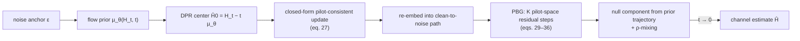

# SRF: Pilot-Aware Surrogate Refinement for Flow-Based MIMO Channel Estimation

Official code release for the paper:

> **SRF: Pilot-Aware Surrogate Refinement for Flow-Based MIMO Channel Estimation**
> Ruixuan Li, Shuai Wang, Lingxiang Li, Zhi Chen, and Hongwei Wang
> National Key Laboratory of Wireless Communications, University of Electronic Science and Technology of China (UESTC)
> *Accepted to IEEE Global Communications Conference (GLOBECOM) 2026, Macau, China*

[](LICENSE)


---

## Abstract

Accurate channel state information (CSI) is essential for massive MIMO, but
limited pilots make channel recovery underdetermined. This regime is naturally
Bayesian: pilots define a likelihood that constrains only pilot-observable
channel components, while the channel prior must infer the remaining
pilot-null-space ambiguity. We propose **surrogate-refined flow (SRF)**, a
pilot-aware flow-based estimator that couples a learned channel prior with a
closed-form pilot-consistency update. **Distribution-aware prior refinement
(DPR)** improves the prior-side clean-channel center, and **posterior bridge
guidance (PBG)** corrects post-reembedding pilot mismatch in the
pilot-observable space while preserving prior-controlled null components. CDL
experiments show complementary gains across SNR and pilot-density regimes.

## Method at a glance

The pilot operator `H -> HP` is non-injective when `N_p < N_t`, so the channel
splits into a **pilot-observable** component `H_R = H S_P` and a **pilot-null**
component `H_N = H S_P^⊥`. SRF keeps the flow backbone of RC-Flow and adds two
lightweight refinements around the closed-form pilot-consistent update:

| Component | Idea | Cost |
|---|---|---|
| **DPR** | Train the velocity field as a single-Gaussian conditional distribution with finite-transition NLL (`r = 0.5`), then use the refined clean-channel center `Ĥ0 = H_t - t μ_θ(H_t,t)` in the proximal update | no extra network forward pass at inference |
| **PBG** | After re-embedding the corrected estimate into the clean-to-noise path, correct the residual in the received-pilot domain with `K` pilot-space gradient steps; keep the null component from the prior trajectory | `O(K N_r N_t N_p)` per reverse step, no extra learned module |



Code ↔ paper terminology:

| Paper | Code (`src/srf/`) | Legacy name |
|---|---|---|
| DPR (prior refinement) | `training.GMFlowObjective`, `sampler` center | `GMFlow`, `gm1tr05` |
| PBG (posterior bridge guidance) | `physics.pbg_*`, `sampler` | `FIG`, `fig`, `fig_plus` |
| SRF-P (DPR only) | `SamplerConfig(mode="srf_p")` | `baseline` |
| SRF (DPR + PBG) | `SamplerConfig(mode="srf")` | `fig_plus` |

See [`docs/METHOD.md`](docs/METHOD.md) for the equations and
[`docs/NAMING.md`](docs/NAMING.md) for the full legacy-name mapping.

## Repository structure

```
.
├── configs/                      # YAML configs (paper main setting, eval, smoke test)
├── data_generation/              # MATLAB CKM-SRF dataset generator + .mat converter
│   ├── run_demo.m                # small end-to-end generator demo
│   ├── generate_ckm_srf_dataset.m
│   ├── src/, tests/, docs/       # generator internals, tests and schema docs
│   └── prepare_srf_mat.py        # generator shards -> SRF `.mat` contract
├── docs/
│   ├── DATA.md                   # data contract + how the CDL data was generated
│   ├── METHOD.md                 # DPR/PBG equations and code mapping
│   └── NAMING.md                 # legacy name -> paper name mapping
├── results/table1.md             # reference numbers from the paper (Table I)
├── scripts/
│   ├── train.py                  # training entry point (DPR / GM-NLL objective)
│   ├── evaluate.py               # NMSE evaluation / Table I reproduction
│   └── generate_synthetic_data.py# synthetic .mat data for smoke tests
├── src/srf/                      # the importable package
│   ├── models.py                 # U-Net backbone with Gaussian-mixture head
│   ├── gm.py                     # Gaussian-mixture math
│   ├── physics.py                # pilot range/null projections, PBG, proximal update
│   ├── sampler.py                # SRF / SRF-P / PBG-only reverse sampler
│   ├── baselines/                # RC-Flow and FLOWER comparison samplers
│   ├── data.py                   # .mat CDL dataset loader
│   ├── training.py               # training objectives + checkpoint helpers
│   └── utils.py                  # reverse-step schedule
└── tests/                        # smoke tests (CPU, tiny tensors)
```

## Installation

```bash
git clone https://github.com/LRXuanxuan/srf-pilot-aware-flow.git
cd srf-pilot-aware-flow

python -m venv .venv
source .venv/bin/activate        # Windows: .venv\Scripts\activate
pip install -r requirements.txt
# or, to install the package in editable mode:
pip install -e .
```

The code was tested with Python 3.13 and PyTorch 2.15 (CPU) for the smoke
test; any PyTorch `>= 2.1` should work. A CUDA GPU is recommended for training
the full model but is **not** required for the smoke test.

## Data

The CDL channel data used in the paper are **not** committed to git (large,
generated externally). Two options are provided:

1. **Use the MATLAB generator in [`data_generation/`](data_generation/)** — a
   self-contained CKM-SRF scene generator (no 5G Toolbox) that synthesises
   `H(rx, tx, subcarrier, snapshot, sample)` channels, pilots, CKM features and
   path-level ground truth. Convert its shards to the release format with
   `data_generation/prepare_srf_mat.py`. The generator produces geometrically
   defined scenes (not 3GPP CDL profiles), so use it for training and
   physics-consistency prototyping; small numerical differences from the paper
   table are expected.
2. **Use your own CDL-A/B/C/D data** — the expected `.mat` layout
   (`H_train` / `H_val` / `H_test`, shape `(N_r, N_t, N_samples)`) and the
   pilot/noise model are documented in [`docs/DATA.md`](docs/DATA.md). The main
   paper setting is `N_r = 16`, `N_t = 64`, `α = N_p/N_t = 0.6` (`N_p = 38`),
   CDL-A/B/C/D, 100 test realizations per profile.

For a quick end-to-end check without any external data:

```bash
python scripts/generate_synthetic_data.py \
    --output-dir data/synthetic \
    --num-rx 8 --num-tx 16 --n-train 32 --n-val 8 --n-test 16
```

## Training

Train the SRF backbone (DPR objective, `r = 0.5`) with the paper main setting:

```bash
python scripts/train.py --config configs/srf_cdl_16x64_alpha06.yaml
```

Useful flags: `--data-dir`, `--output-dir`, `--epochs`, `--batch-size`, `--lr`,
`--device {auto,cpu,cuda}`, `--seed`. The best validation checkpoint is written
to `<output_dir>/best_model.pt` (with the model/config metadata needed for
evaluation).

## Evaluation and reproducing the paper table

```bash
python scripts/evaluate.py \
    --config configs/eval_cdl_16x64_alpha06.yaml \
    --checkpoint outputs/srf_cdl_16x64_alpha06/best_model.pt \
    --samplers srf_p srf \
    --output-json results/table1_srf.json
```

- `--samplers srf_p` -> **SRF-P** row (DPR without PBG)
- `--samplers srf`   -> **SRF** row (DPR + PBG)
- `--samplers rcflow` / `flower` -> comparison samplers in `src/srf/baselines/`
  (they require checkpoints trained for those baselines)

The script prints per-CDL and averaged NMSE in dB, and writes JSON/CSV results.
Reference numbers from the accepted paper are listed in
[`results/table1.md`](results/table1.md). Classical baselines (LMMSE, LASSO,
fsAD, LDAMP, DMCE) are not redistributed with this code.

## Checkpoints

Trained checkpoints will be linked here when released. To evaluate a checkpoint
you trained yourself, pass its path with `--checkpoint`; the model architecture
and instance settings are restored from the checkpoint metadata written by
`scripts/train.py`.

## Citation

If you find this code useful, please cite:

```bibtex
@inproceedings{li2026srf,
  title     = {{SRF}: Pilot-Aware Surrogate Refinement for Flow-Based {MIMO} Channel Estimation},
  author    = {Li, Ruixuan and Wang, Shuai and Li, Lingxiang and Chen, Zhi and Wang, Hongwei},
  booktitle = {IEEE Global Communications Conference (GLOBECOM)},
  address   = {Macau, China},
  year      = {2026},
  note      = {To appear}
}
```

A [CITATION.cff](CITATION.cff) file is included for GitHub's citation widget.

## License and paper copyright

The code is released under the [MIT License](LICENSE). The paper itself is
copyrighted by IEEE; this repository does **not** redistribute the paper PDF.
Please refer to IEEE Xplore for the published version.

## Acknowledgments

This work was supported in part by the Mobile Information Networks–National
Science and Technology Major Project under Grant No. 2025ZD1305200, and in part
by the National Key Research and Development Program of China under Grant
No. 2024YFE0200400.

## Contact

Please open a GitHub issue for questions about the code, or contact
[@LRXuanxuan](https://github.com/LRXuanxuan).
